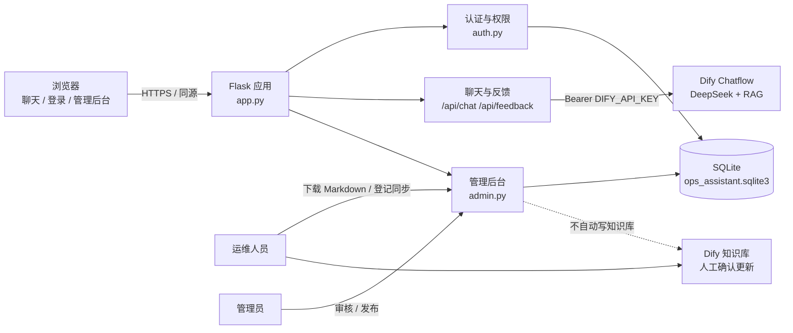
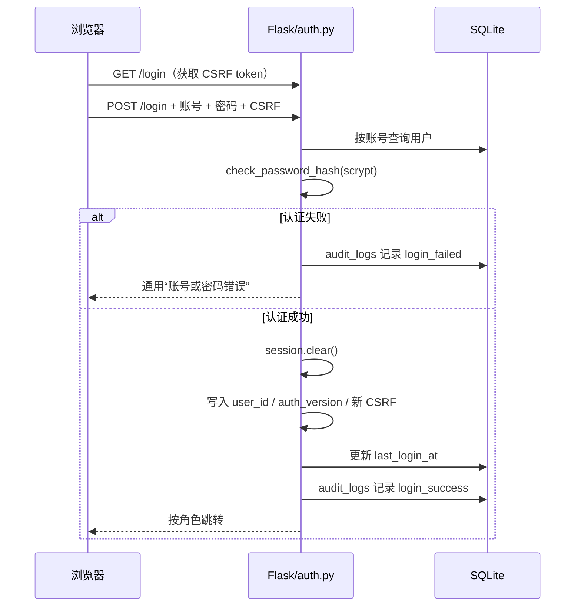
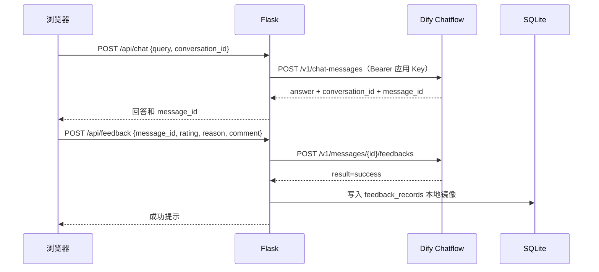
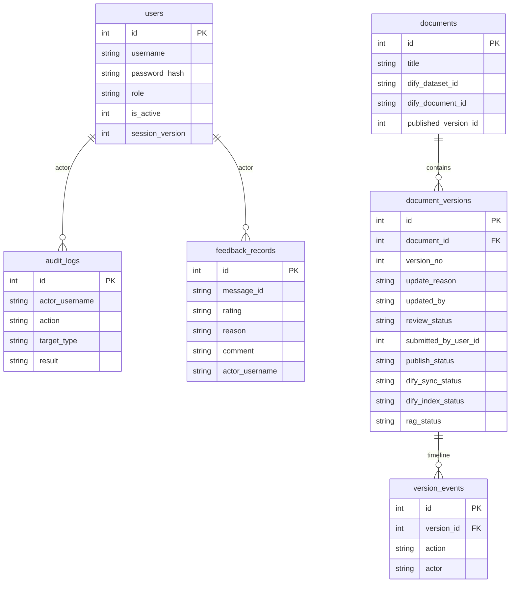

# 系统架构

> 企业智能运维知识助手 V1.4<br>
> 适用代码：`auth.py`、`admin.py`、`documents.py`、`feedback_store.py`、`app.py`

## 1. 架构目标

系统在保留 Dify Chatflow 问答、点赞点踩和文档版本能力的基础上，增加了三类角色与权限隔离：

- 普通员工使用问答与反馈；
- 运维人员维护文档版本、Dify 同步、索引和 RAG 验证；
- 管理员审核、发布、管理用户和查看审计日志。

RAG 不在本项目重新实现；Dify 仍然是知识库检索和 DeepSeek 回答的运行时。

## 2. 总体架构图



### 运行边界

| 组件 | 职责 | 不负责 |
| --- | --- | --- |
| Flask | 页面、API 代理、权限、状态机 | 不实现向量检索 |
| Dify Chatflow | RAG 检索、DeepSeek 回答、原生反馈 | 不保存本地流程状态 |
| SQLite | 用户、角色、文档版本、反馈镜像、审计 | 不保存 Dify API Key |
| 运维人员 | 版本维护、Dify 更新、索引、RAG 登记 | 不能审核、不能发布 |
| 管理员 | 审核、发布、用户角色、审计 | 不能审核自己提交的版本 |

## 3. 代码模块

```text
app.py
├── create_app()                  Flask 工厂
├── Session 加载 / CSRF token
├── GET  /                       聊天页面
├── POST /api/chat               Dify 问答代理
├── POST /api/feedback           Dify 反馈 + 本地镜像
└── GET  /api/health             健康检查

auth.py
├── ROLE_PERMISSIONS             三角色权限矩阵
├── UserRepository               scrypt 密码、用户、session_version
├── AuditRepository              审计日志
├── auth_bp                      /login、/logout
├── permission_required          路由级权限装饰器
├── validate_csrf                CSRF 校验
└── ensure_initial_admin         安全初始化管理员

admin.py
├── /admin/documents/**          文档列表、详情、版本、审核、发布
├── /admin/feedback              反馈记录
├── /admin/users                 用户管理
├── /admin/roles                 角色矩阵
└── /admin/audit                 操作日志

documents.py
├── documents / document_versions / version_events
├── 审核状态机
├── 提交人快照
├── Dify 同步 + 索引状态
├── RAG 验证
└── 发布 + 旧版本归档

feedback_store.py
└── feedback_records 本地镜像
```

## 4. 认证与会话

### 登录流程



### Session 失效机制

- `users.session_version` 是服务端版本号；
- 登录时把版本号写入 signed session；
- 每个请求加载用户后比较数据库版本和 session 版本；
- 退出、修改角色、停用账号、重置密码都会递增版本；
- 旧 Cookie 即使未过期，也会因为版本不匹配被清空。

## 5. 问答与反馈链路



Dify 原生反馈仍是权威数据源；SQLite 中的 `feedback_records` 仅用于管理后台展示。

## 6. 文档治理数据模型



## 7. 关键请求路径

| 路径 | 认证 | 作用 |
| --- | --- | --- |
| `GET /` | 否 | 聊天页面 |
| `GET/POST /login` | 否 | 登录 |
| `POST /logout` | 是 + CSRF | 退出并使旧 Session 失效 |
| `POST /api/chat` | 否 | Dify 问答 |
| `POST /api/feedback` | 否 | Dify 反馈，写本地镜像 |
| `/admin/documents/**` | operator/admin | 文档版本工作流 |
| `/admin/feedback` | operator/admin | 反馈记录 |
| `/admin/users` | admin | 用户管理 |
| `/admin/roles` | admin | 权限矩阵 |
| `/admin/audit` | admin | 审计日志 |

## 8. 部署假设

- Windows 单机或小团队内网；
- Flask 开发服务器用于本地实践，正式部署应使用 WSGI 服务器；
- SQLite 适合单实例，不适合多进程高并发；
- Dify Chatflow 运行在云端或独立环境；
- Dify 知识库更新需要人工确认，V1.4 不自动写入；
- 生产环境必须使用 HTTPS、强 `SECRET_KEY`、强管理员密码和备份策略。

## 9. 安全边界

1. 聊天 API 不接触用户浏览器中的 Dify Key；
2. 管理后台的未登录访问被重定向；
3. 普通员工访问 `/admin` 返回 403；
4. 运维人员不能审核或发布；
5. 提交人不能审核自己提交的版本；
6. 发布前必须满足审核、同步、索引和 RAG 条件；
7. 所有管理 POST 都要求 CSRF；
8. 密码只保存 scrypt 哈希；
9. `.env`、SQLite、截图和虚拟环境不进入 Git。

详细角色矩阵见 [权限矩阵](permissions.md)，业务过程见 [业务流程](business-flow.md)，测试记录见 [测试报告](test-report.md)。
