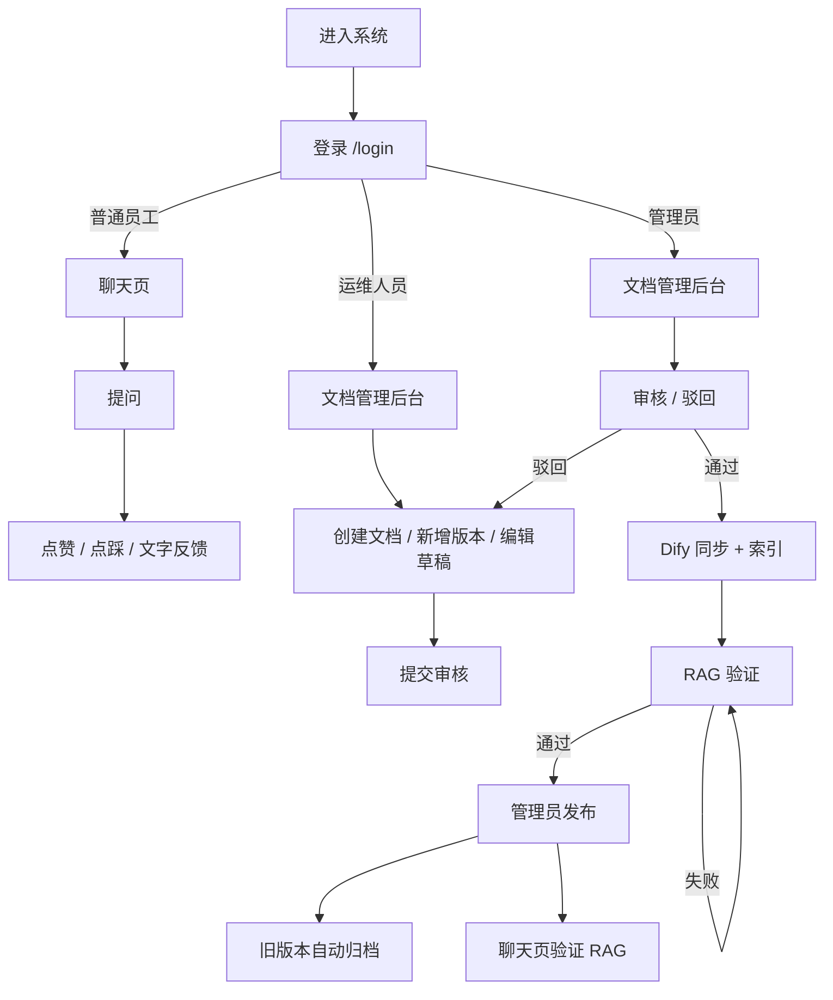
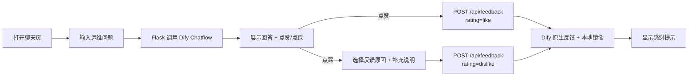
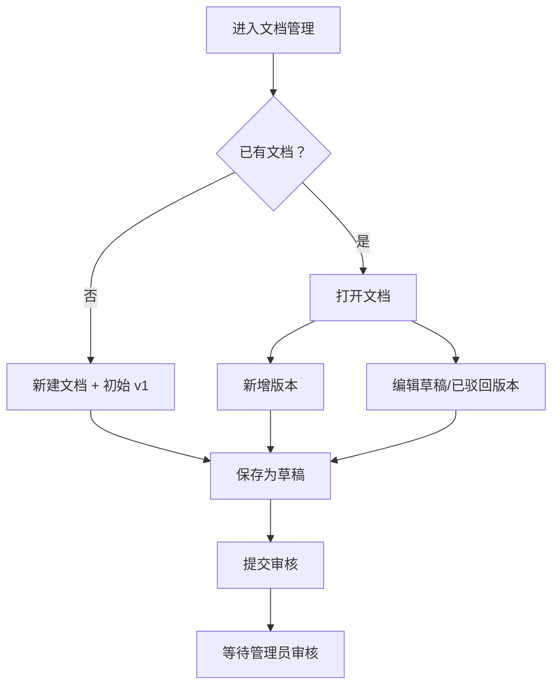
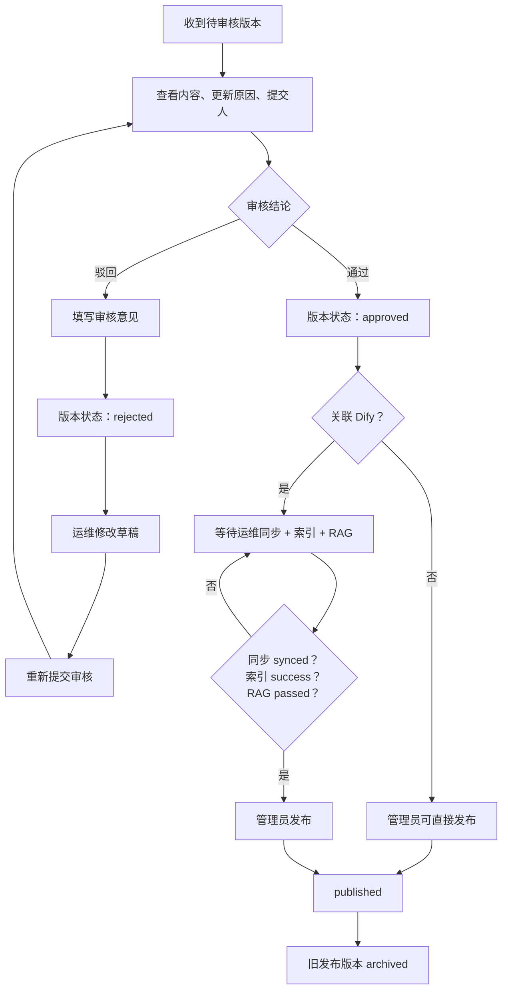
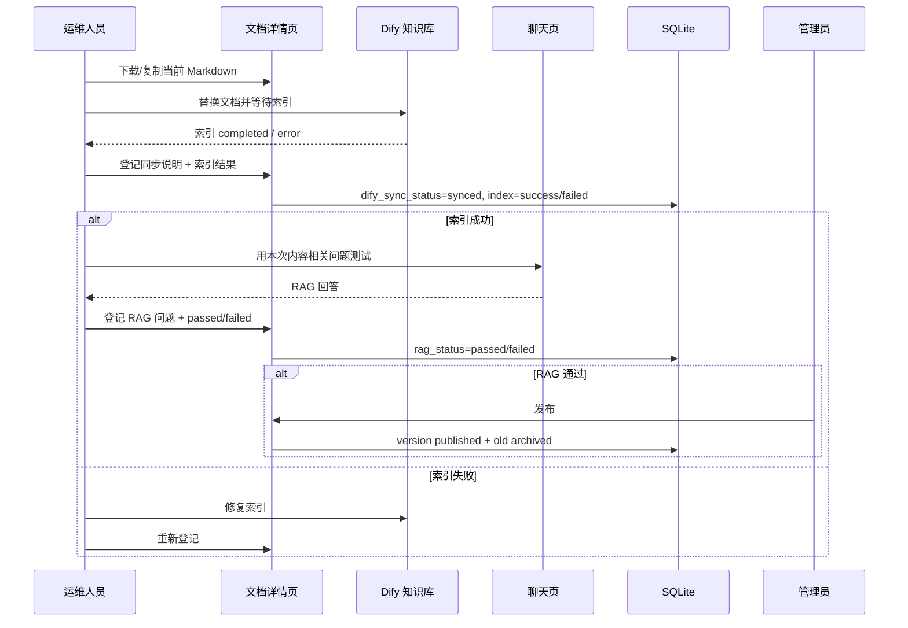
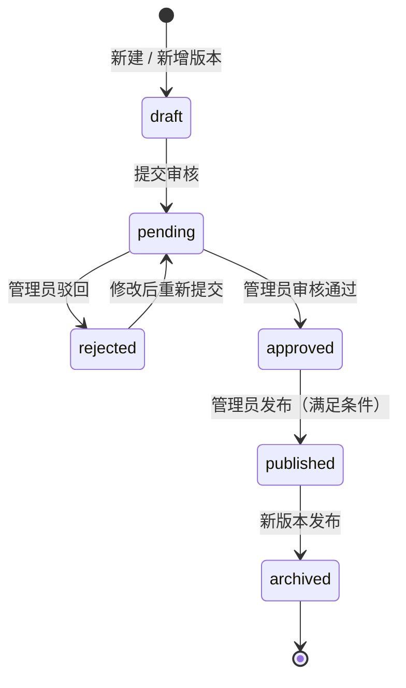
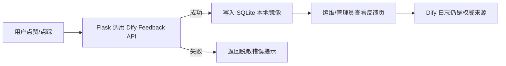
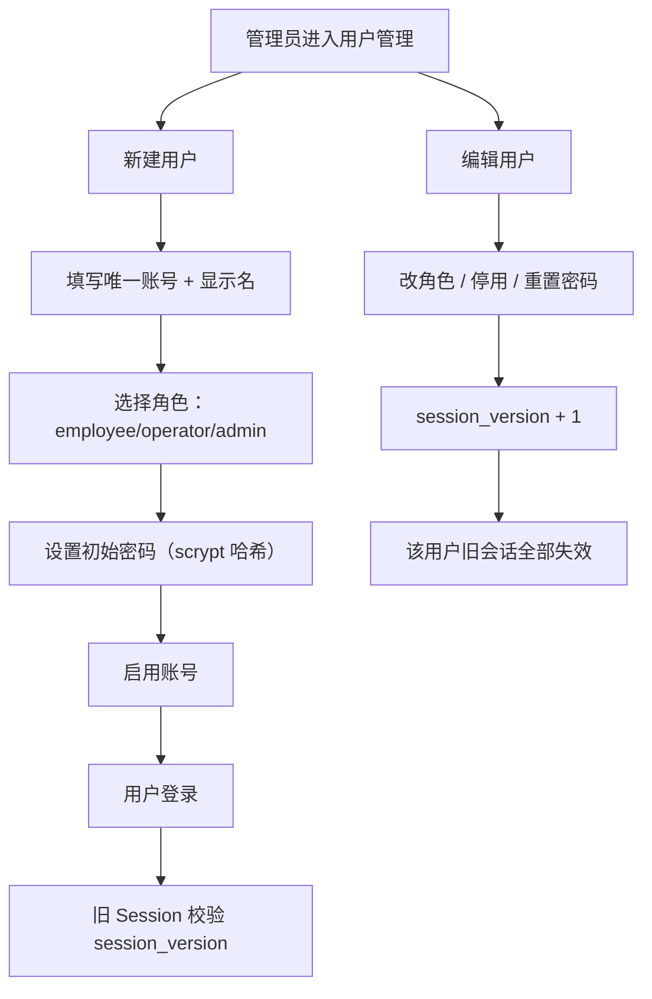

# 业务流程

> 企业智能运维知识助手 V1.4<br>
> 覆盖问答反馈、文档版本、审核发布、Dify 同步与 RAG 验证。

## 1. 角色旅程总览



> 聊天页保留公开入口；登录后显示角色和后台菜单。所有管理动作都要求登录并由后端校验权限。

## 2. 普通员工：问答与反馈



规则：

- 普通员工不能访问管理后台；
- 不能查看反馈管理记录；
- 不能创建、编辑、审核、发布文档；
- 同一条消息不能重复反馈。

## 3. 运维人员：维护文档版本



运维人员可以：

- 创建文档和版本；
- 编辑文档信息与草稿；
- 提交审核；
- 下载或复制 Markdown；
- 登记 Dify 同步、索引状态；
- 执行并登记 RAG 验证。

运维人员不能：

- 审核文档；
- 发布文档；
- 访问用户、角色、审计页面。

## 4. 管理员：审核与发布



发布强制条件：

1. 审核状态 `approved`；
2. 提交人不能是审核人；
3. 关联 Dify 时：同步 `synced`、索引 `success`、RAG `passed`；
4. 只有管理员拥有 `documents.publish` 权限；
5. 发布后旧发布版本自动归档。

## 5. Dify 同步、索引与 RAG 验证



V1.4 不自动调用 Dify 知识库写接口。完整操作手册见 [Dify 知识库更新衔接流程](dify-sync-workflow.md)。

## 6. 文档状态机



### 发布状态

```text
unpublished
  ├── published
  │      └── archived（新版本发布时自动归档）
  └── archived（历史不可重新发布）
```

> 归档版本不可重新发布；回滚应创建新版本，保留历史链路。

## 7. 反馈记录流程



反馈页只对运维人员和管理员开放，普通员工访问返回 403。

## 8. 用户与角色管理流程



安全限制：

- 只有一个启用管理员时，不能停用或降级该管理员；
- 管理员不能修改自己的角色或停用自己；
- 管理员不能审核自己提交的版本；
- 角色变更、停用和密码重置都会让旧 Session 失效。

## 9. 操作审计流程

关键操作写入 `audit_logs`：

- 登录成功 / 失败、退出；
- 创建/编辑用户、重置密码；
- 创建/编辑文档、创建/编辑版本、提交审核；
- 审核通过 / 驳回；
- 登记 Dify 同步、索引、RAG 验证；
- 发布版本。

审计记录字段：

```text
操作人 + 操作时间 + 操作类型 + 对象 + 结果 + 说明 + IP
```

管理员可以在 `/admin/audit` 查看和筛选；其他角色不可访问。

## 10. 失败与回滚

| 场景 | 处理 |
| --- | --- |
| Dify 索引失败 | 不登记 RAG 通过，不发布；修复 Dify 后重新登记 |
| RAG 验证失败 | 修正知识库或测试问题；重新验证 |
| 发布内容错误 | 下载上一个归档版本，新建版本回滚，重新走审核/同步/RAG/发布 |
| 用户被停用 | 旧 Session 失效，无法登录 |
| 角色变更 | 旧 Session 失效，按新角色重新加载菜单 |
| 管理员自审 | 后端拒绝，换另一位管理员 |

详细状态与字段见 [系统架构](architecture.md) 和 [权限矩阵](permissions.md)。
